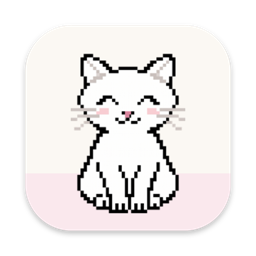
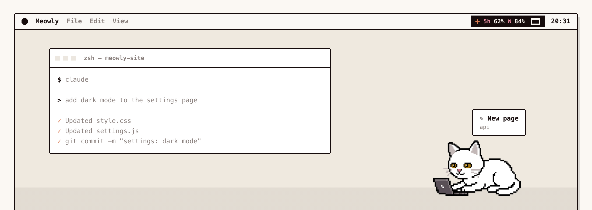
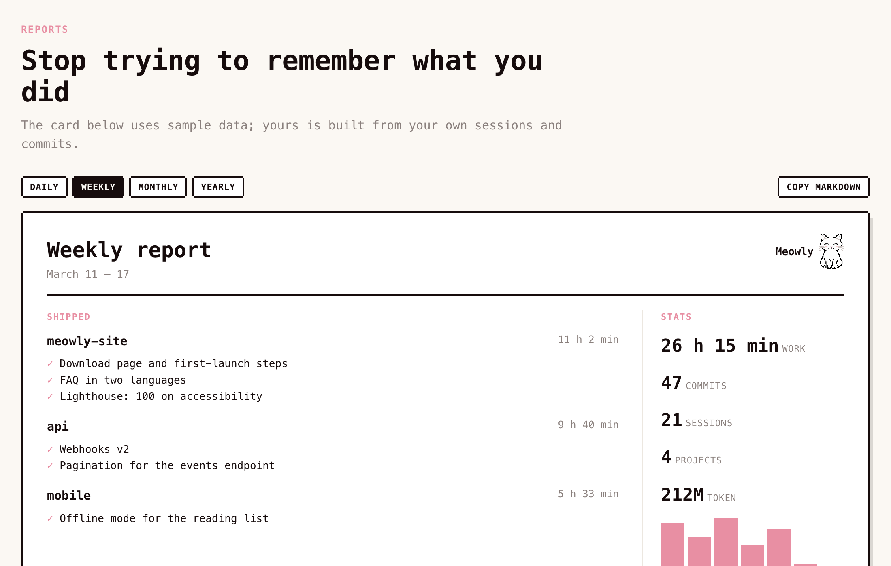
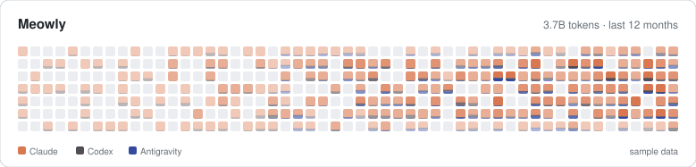

# Meowly

### You write the code. Your cat takes notes.

A pixel cat that lives on your Mac desktop. Your Claude and Codex limits sit in the menu bar; 
your AI coding sessions and commits turn into a diary and reports on their own.

&nbsp;

[Türkçe](README.md) · [Report a bug](https://github.com/mertpural/meowly/issues)

## What it does

- **Limits in the menu bar.** Claude and Codex 5-hour and weekly limits at a glance.
- **A diary that writes itself.** Which project, how long, how many tokens, which commits.
- **Reports in one click.** Daily, weekly, monthly and yearly; copy as a standup note or save as an image.
- **Computer log.** Time per app and per site, meetings and file changes. Every layer can be turned off.
- **A cat that lives.** Types when you type, naps when you leave, purrs when petted. You pick the name.

## GitHub profile card

A year of token usage on your profile README. Daily totals only; no projects or chats.

<a href="https://meowly.vercel.app/#github">
<picture>
  <source media="(prefers-color-scheme: dark)" srcset="assets/card-en-dark.svg">
  
</picture>
</a>

## Privacy

No server, no account. Everything stays on your Mac. It never reads your chats, your screen, your keystrokes or your files' contents.

### [→ meowly.vercel.app](https://meowly.vercel.app)

Free · macOS 14 or later · Apple Silicon and Intel

If Meowly makes your day a little nicer, a ⭐ helps others find it.

The source code is not public; this repository holds releases, documentation and issues.

