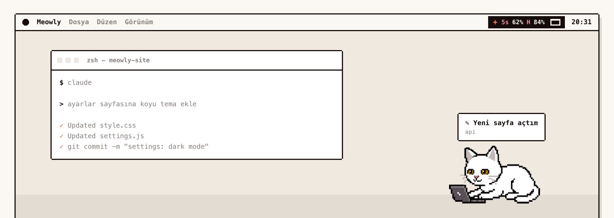
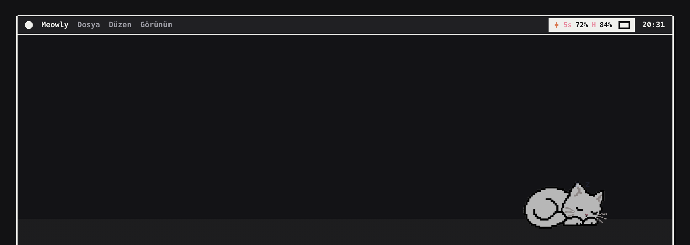
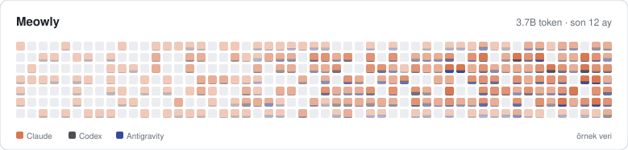

# Meowly

### Kodunu yaz. Kedin not alsın.

Mac ve Windows masaüstünde yaşayan piksel bir kedi. Claude ve Codex limitlerin menü çubuğunda (Windows'ta görev çubuğunda); 
yapay zekâ oturumların ve commit'lerin kendiliğinden günlüğe ve rapora dönüşür.

&nbsp;

[English](README.en.md) · [Hata bildir](https://github.com/mertpural/meowly/issues)

## Sen çalışırken o da çalışır

Claude ya da Codex'i açtığında kedin laptopunun başına geçer, hangi projede olduğunu not eder.
Limitlerin menü çubuğunda; bitmeye yakınken kedin söyler.

## Mola verince günlüğe yazar

Her oturum süresi, token sayısı ve attığın commit'lerle **Günlük**'e düşer. Uzun oturumda mola hatırlatır.

## Gün sonunda rapor hazır

Günlük, haftalık, aylık ve yıllık rapor. Standup notu olarak kopyala ya da resim olarak paylaş.

## Sen uzaktayken uyur

Bilgisayardan kalkınca kıvrılıp uyur, dönünce esneyip uyanır. Okşayınca mırlar, enseden tutup taşıyabilirsin.
**Adını sen koyarsın.**

## GitHub profil kartı

Bir yıllık token kullanımın profil README'nde. Kareler servise göre renklenir; içinde yalnızca günlük toplamlar var.

<a href="https://meowly.vercel.app/#github">
<picture>
  <source media="(prefers-color-scheme: dark)" srcset="assets/card-tr-dark.svg">
  
</picture>
</a>

## Kaynak kodu

Meowly açık kaynaktır: kod [GPL-3.0](LICENSE) ile lisanslıdır. Kedinin çizimleri, "Meowly" adı ve logosu bu lisansa dahil değildir ([ASSETS-LICENSE.md](ASSETS-LICENSE.md)).

| Klasör | İçerik | Derlemek |
|---|---|---|
| [`mac/`](mac) | Swift / SwiftUI, macOS 14+ | `cd mac && scripts/build_app.sh` |
| [`windows/`](windows) | Tauri 2 (Rust + WebView2), Windows 10/11 | `cd windows && npm install && npx tauri build` |

Kendin derlediğin sürüm kendini güncellemez; güncellemeler yalnızca sitedeki imzalı sürümlere gelir.

## Gizlilik

Sunucu yok, hesap yok. Her şey kendi bilgisayarında kalır. Sohbetlerini, ekranını, bastığın tuşları ve dosyalarının içeriğini asla okumaz.

### [→ meowly.vercel.app](https://meowly.vercel.app)

Ücretsiz · macOS 14+ (Apple Silicon ve Intel) · Windows 10/11 (64 bit)

Meowly gününü biraz güzelleştiriyorsa bir ⭐ başkalarının da bulmasına yardım eder.

Kaynak kodu GPL-3.0 ile açık; hata bildirimleri ve öneriler için Issues.

