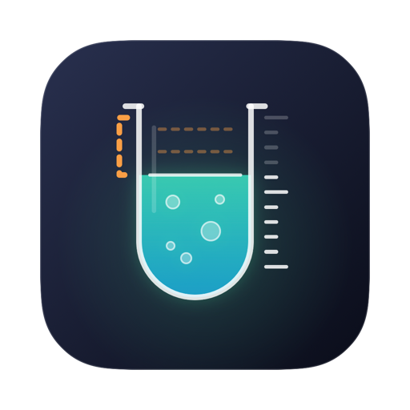
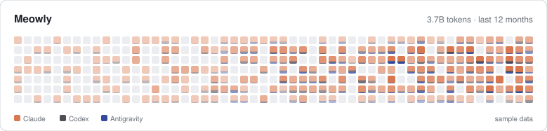

# Meowly

**You write the code. Your cat takes notes.**

A pixel cat that lives on your Mac desktop, shows your Claude and Codex limits in the menu bar,
and turns your AI coding sessions and commits into daily, weekly and monthly reports.

[Website](https://meowly.vercel.app) · [Download](https://meowly.vercel.app/#download) · [Report a bug](https://github.com/mertpural/meowly/issues) · [Türkçe](README.tr.md)

 &nbsp;  &nbsp; 

## What it does

- **Limits in the menu bar.** Claude and Codex 5-hour and weekly limits at a glance.
- **A diary that writes itself.** Which project, how long, how many tokens, which commits.
- **Reports in one click.** Daily, weekly, monthly and yearly; copy as a standup note or save as an image.
- **Computer log.** Time per app and per site, meetings and file changes. Every layer can be turned off.
- **A cat that lives.** Types when you type, naps when you leave, purrs when petted. You pick the name.
- **GitHub profile card.** A year of token usage on your profile README:

<picture>
  <source media="(prefers-color-scheme: dark)" srcset="assets/card-en-dark.svg">
  
</picture>

## Privacy

Meowly has no server and no account. Everything stays on your Mac. It never reads your chats,
your screen, your keystrokes or the contents of your files.

## Install

Free, macOS 14 or later. Download from the [website](https://meowly.vercel.app/#download), unzip and move
Meowly to Applications. On first launch macOS asks once: **System Settings → Privacy & Security → Open Anyway**.

## Feedback

Found a bug or have an idea? [Open an issue](https://github.com/mertpural/meowly/issues).
If Meowly makes your day a little nicer, a ⭐ helps others find it.

---

Meowly is free to use. The source code is not public; this repository holds releases, documentation and issues.
