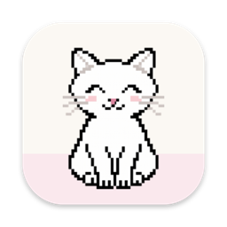
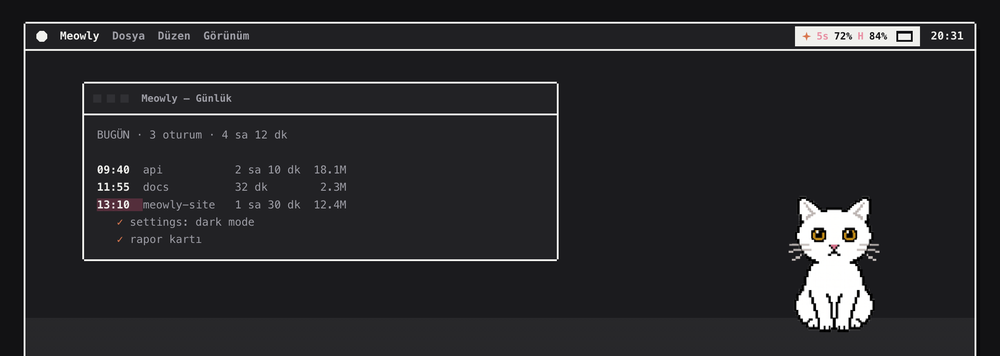
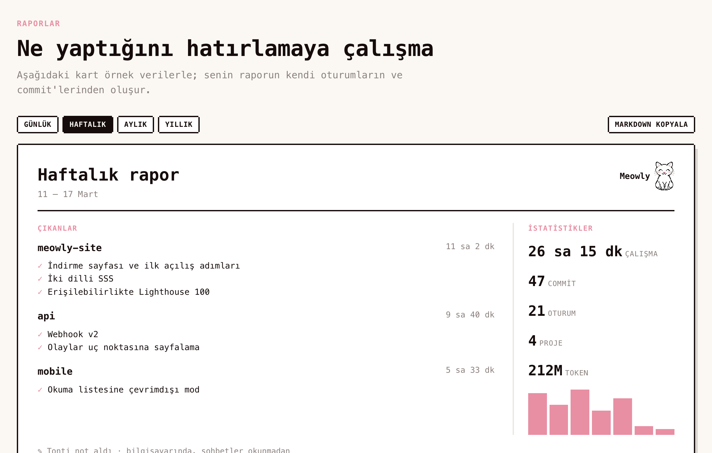

# Meowly

### Kodunu yaz. Kedin not alsın.

Mac masaüstünde yaşayan piksel bir kedi. Claude ve Codex limitlerin menü çubuğunda; 
yapay zekâ oturumların ve commit'lerin kendiliğinden günlüğe ve rapora dönüşür.

&nbsp;

[English](README.en.md) · [Hata bildir](https://github.com/mertpural/meowly/issues)

## Sen çalışırken o da çalışır

Claude ya da Codex'i açtığında kedin laptopunun başına geçer, hangi projede olduğunu not eder.
Limitlerin menü çubuğunda; bitmeye yakınken kedin söyler.

## Mola verince günlüğe yazar

Her oturum süresi, token sayısı ve attığın commit'lerle **Günlük**'e düşer. Uzun oturumda mola hatırlatır.

## Gün sonunda rapor hazır

Günlük, haftalık, aylık ve yıllık rapor. Standup notu olarak kopyala ya da resim olarak paylaş.

## Sen uzaktayken uyur

Bilgisayardan kalkınca kıvrılıp uyur, dönünce esneyip uyanır. Okşayınca mırlar, sürükleyip taşıyabilirsin.
**Adını sen koyarsın.**

## GitHub profil kartı

Bir yıllık token kullanımın profil README'nde. Kareler servise göre renklenir; içinde yalnızca günlük toplamlar var.

<a href="https://meowly.vercel.app/#github">
<picture>
  <source media="(prefers-color-scheme: dark)" srcset="assets/card-tr-dark.svg">
  
</picture>
</a>

## Gizlilik

Sunucu yok, hesap yok. Her şey Mac'inde kalır. Sohbetlerini, ekranını, bastığın tuşları ve dosyalarının içeriğini asla okumaz.

### [→ meowly.vercel.app](https://meowly.vercel.app)

Ücretsiz · macOS 14 ve üstü · Apple Silicon ve Intel

Meowly gününü biraz güzelleştiriyorsa bir ⭐ başkalarının da bulmasına yardım eder.

Kaynak kodu herkese açık değildir; bu depo sürümleri, belgeleri ve hata bildirimlerini tutar.

