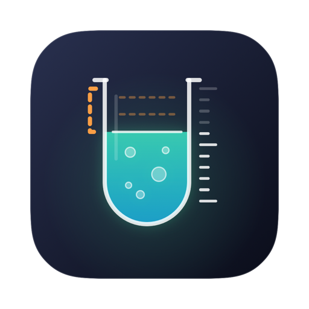

# Meowly

**Kodunu yaz. Kedin not alsın.**

Mac masaüstünde yaşayan piksel bir kedi. Claude ve Codex limitlerini menü çubuğunda gösterir,
yapay zekâ oturumlarını ve commit'lerini günlük, haftalık ve aylık rapora çevirir.

[Site](https://meowly.vercel.app) · [İndir](https://meowly.vercel.app/#download) · [Hata bildir](https://github.com/mertpural/meowly/issues) · [English](README.md)

 &nbsp;  &nbsp; 

## Neler yapar

- **Limitler menü çubuğunda.** Claude ve Codex'in 5 saatlik ve haftalık limitleri tek bakışta.
- **Günlük kendiliğinden yazılır.** Hangi projede ne kadar çalıştın, kaç token harcadın, hangi commit'leri attın.
- **Raporlar tek tıkla.** Günlük, haftalık, aylık ve yıllık; standup notu olarak kopyala ya da resim olarak kaydet.
- **Bilgisayar günlüğü.** Uygulama ve site başına süre, toplantılar ve dosya değişiklikleri. Her katman kapatılabilir.
- **Yaşayan bir kedi.** Sen yazarken yazar, kalkınca uyur, okşayınca mırlar. Adını sen koyarsın.
- **GitHub profil kartı.** Bir yıllık token kullanımın profil README'nde.

## Gizlilik

Meowly'nin sunucusu ve hesabı yok. Her şey Mac'inde kalır. Sohbetlerini, ekranını, bastığın tuşları
ve dosyalarının içeriğini asla okumaz.

## Kurulum

Ücretsiz, macOS 14 ve üstü. [Siteden](https://meowly.vercel.app/#download) indir, zip'i aç, Meowly'yi
Uygulamalar'a taşı. İlk açılışta macOS bir kez sorar: **Sistem Ayarları → Gizlilik ve Güvenlik → Yine de Aç**.

## Geri bildirim

Hata mı buldun, fikrin mi var? [Bildir](https://github.com/mertpural/meowly/issues).
Meowly gününü biraz güzelleştiriyorsa bir ⭐ başkalarının da bulmasına yardım eder.

---

Meowly ücretsizdir. Kaynak kodu herkese açık değildir; bu depo sürümleri, belgeleri ve hata bildirimlerini tutar.
